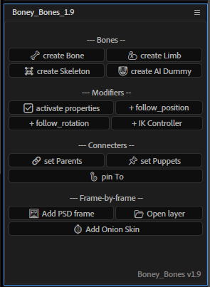
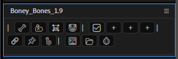

  

<h1 align="center">Boney Bones</h1>

  A toolset for fast and convenient character rigging in After Effects. 
  Набор инструментов для быстрого и удобного рига персонажей в After Effects.

  <b>Version 1.9</b> · After Effects 24.x or newer · Author: Petrusha Petrovich · <a href="mailto:syslef@gmail.com">syslef@gmail.com</a>

---

[English](#english) · [Русский](#русский)

---

## English

### What it is

A launcher panel (`Boney_Bones_1.9.jsx`) with buttons that run the scripts and presets from the `boney_files` folder. Buttons are grouped by rigging stage: creating bones, behaviour modifiers, linking layers and frame-by-frame tools.

The panel wraps buttons onto several rows and collapses into a compact mode (emoji-only buttons) when space is short; full names show in hover tooltips.

  
  &nbsp;&nbsp;&nbsp;
  

### Tools

#### Bones

| Button | What it does |
|---|---|
| 🦴 **create Bone** | Create a bone: an empty shape layer at the comp center with the `create_bone.ffx` preset and rig expressions. |
| 💪 **create Limb** | Copy the `boney_limb` rig (shoulder / elbow / hand chain) from `boney_template.aep` into the active comp. |
| ☠️ **create Skeleton** | Copy the `boney_skeleton` rig from `boney_template.aep`, restoring parents; `C \| NULL` is centered in the comp. |
| 🤡 **create AI Dummy** | Copy the `boney_dummy` test character for rig testing. |

#### Modifiers

| Button | What it does |
|---|---|
| ✅ **activate properties** | Put the rig expressions on Position / Rotation / Scale of the selected layers (plus the preset), so a layer follows the limb effect where it is Point A / B / C. |
| ➕ **follow_position** | Add follow-position (preset + expression on Position). |
| ➕ **follow_rotation** | Add follow-rotation (preset + expression on Rotation). |
| ➕ **IK Controller** | Add an IK controller (preset + expressions on Position / Rotation / Scale). |

#### Connecters

| Button | What it does |
|---|---|
| 🔗 **set Parents** | For each selected layer, set as parent the nearest layer whose comment contains `Structure` or `Bone` (within 50 px). |
| 📌 **set Puppets** | Select ONE layer with Puppet pins and the pins themselves: each selected pin is bound (position, scale, rotation) to the nearest layer whose comment contains `Structure`, `Bone` or `Pin` (within 100 px). |
| 🪝 **pin To** | Select ONE layer with Puppet pins and the pins: creates a `Pinned to` Layer Control effect and binds the pin positions to the layer chosen in it. |

#### Frame-by-frame

| Button | What it does |
|---|---|
| 🖼️ **Add PSD frame** | Render the current frame to PSD into the `Frames` folder (inside `(Footage)` if it exists next to the project), import it above the top selected layer as a 1-frame layer and open it in Photoshop with a clean layer added. The project must be saved first. |
| 📂 **Open layer** | Open the source files of the selected layers in their default apps (PSD opens in Photoshop). |
| 🧅 **Add Onion Skin** | Add an adjustment guide shape layer `Onion Skin` on top of the comp with CC Wide Time and CC Composite; no preset needed. |

### Installation

Download the archive from the [latest release](https://github.com/PetrushaPetrovich/Boney_Bones/releases/latest) and unpack it.

Put `Boney_Bones_1.9.jsx` and the `boney_files` folder into the ScriptUI Panels folder:

| OS | Path |
|---|---|
| Windows | `C:\Program Files\Adobe\Adobe After Effects <ver>\Support Files\Scripts\ScriptUI Panels\` |
| macOS | `/Applications/Adobe After Effects <ver>/Scripts/ScriptUI Panels/` |

Open: **Window → Boney_Bones_1.9.jsx**. Keep the panel and the `boney_files` folder side by side: button paths are relative.

### Usage (general order)

1. Open the composition with the character.
2. **Bones**: create bones / limbs / a skeleton (or a dummy for testing).
3. **Modifiers**: select a layer and add the properties and controllers you need (activate properties, follow_position / rotation, IK Controller).
4. **Connecters**: link the layers: parents, Puppet pins, pin To.
5. **Frame-by-frame**: add PSD frames, open them in Photoshop, add Onion Skin.

Each action is wrapped in its own Undo group, so it is undone with the usual Ctrl+Z.

### Requirements

- After Effects 24.x or newer (the rig is built on expressions, Puppet pins and parenting).
- The `boney_files` folder next to the panel (`.jsx`, `.ffx` and `boney_template.aep`).
- Photoshop for the frame-by-frame tools.

### Repository layout

| Path | Contents |
|---|---|
| `Boney_Bones_1.9.jsx` | The launcher panel. |
| `boney_files/` | Scripts, presets (`.ffx`) and the `boney_template.aep` template. |
| `expressions/` | The rig expressions as plain text: `ikController_sliders.jsx` (IK / FK blend, Follow, Flip, stretch; one text for all `IK_Controller` sliders), `position.jsx` / `rotation.jsx` / `scale.jsx` (bone layer transform wiring), `followPosition_setPosition.jsx` and `followRotation_addRotation.jsx` (the Follow Position / Follow_Rotation effects). |
| `docs/images/` | Logo and screenshots for this page. |
| `sync_from_workdir.ps1` | Copies the published file set from the author's working folder into this repository. |
| `build_release_zip.ps1` | Builds the distribution archive `dist/Boney_Bones_<ver>.zip` (panel + `boney_files` + `README.txt`) for a GitHub Release. |

---

## Русский

### Что это

Панель-лаунчер (`Boney_Bones_1.9.jsx`) с кнопками, которые запускают скрипты и пресеты из папки `boney_files`. Кнопки сгруппированы по этапам рига: создание костей, модификаторы поведения, связывание слоёв и покадровая анимация.

Панель переносит кнопки на несколько строк и сворачивается в компактный режим (кнопки-смайлики) при нехватке места; полные названия видны в подсказках при наведении.

  
  &nbsp;&nbsp;&nbsp;
  

### Инструменты

#### Bones (создание костей)

| Кнопка | Что делает |
|---|---|
| 🦴 **create Bone** | Создать кость: пустой шейп-слой в центре композиции с пресетом `create_bone.ffx` и экспрешенами рига. |
| 💪 **create Limb** | Скопировать риг конечности `boney_limb` (цепочка плечо / локоть / кисть) из `boney_template.aep` в активную композицию. |
| ☠️ **create Skeleton** | Скопировать скелет `boney_skeleton` из `boney_template.aep` с восстановлением родителей; `C \| NULL` центрируется в композиции. |
| 🤡 **create AI Dummy** | Скопировать болвана `boney_dummy` (тестовый персонаж для проверки рига). |

#### Modifiers (модификаторы)

| Кнопка | Что делает |
|---|---|
| ✅ **activate properties** | Поставить экспрешены рига на Position / Rotation / Scale выделенных слоёв (плюс пресет): слой следует за эффектом конечности, где он указан как Point A / B / C. |
| ➕ **follow_position** | Добавить следование за позицией (пресет + экспрешен на Position). |
| ➕ **follow_rotation** | Добавить следование за вращением (пресет + экспрешен на Rotation). |
| ➕ **IK Controller** | Добавить IK-контроллер (пресет + экспрешены на Position / Rotation / Scale). |

#### Connecters (связывание)

| Кнопка | Что делает |
|---|---|
| 🔗 **set Parents** | Каждому выделенному слою назначить родителем ближайший слой, в комментарии которого есть `Structure` или `Bone` (в радиусе 50 px). |
| 📌 **set Puppets** | Выделите ОДИН слой с Puppet-пинами и сами пины: каждый выделенный пин привязывается (позиция, масштаб, вращение) к ближайшему слою с `Structure`, `Bone` или `Pin` в комментарии (в радиусе 100 px). |
| 🪝 **pin To** | Выделите ОДИН слой с Puppet-пинами и пины: создаётся эффект Layer Control `Pinned to`, и позиции пинов привязываются к выбранному в нём слою. |

#### Frame-by-frame (покадровая анимация)

| Кнопка | Что делает |
|---|---|
| 🖼️ **Add PSD frame** | Отрендерить текущий кадр в PSD в папку `Frames` (внутри `(Footage)`, если она лежит рядом с проектом), импортировать его над верхним выделенным слоем длиной в один кадр и открыть в Photoshop с добавленным чистым слоем. Проект должен быть сохранён. |
| 📂 **Open layer** | Открыть исходники выделенных слоёв в приложениях по умолчанию (PSD откроется в Photoshop). |
| 🧅 **Add Onion Skin** | Добавить наверх композиции корректирующий направляющий шейп-слой `Onion Skin` с CC Wide Time и CC Composite; пресет не нужен. |

### Установка

Скачайте архив из [последнего релиза](https://github.com/PetrushaPetrovich/Boney_Bones/releases/latest) и распакуйте его.

Положите `Boney_Bones_1.9.jsx` и папку `boney_files` в папку ScriptUI Panels:

| ОС | Путь |
|---|---|
| Windows | `C:\Program Files\Adobe\Adobe After Effects <ver>\Support Files\Scripts\ScriptUI Panels\` |
| macOS | `/Applications/Adobe After Effects <ver>/Scripts/ScriptUI Panels/` |

Откройте: **Window → Boney_Bones_1.9.jsx**. Панель и папку `boney_files` держите рядом: пути в кнопках относительные.

### Использование (общий порядок)

1. Откройте композицию с персонажем.
2. **Bones**: создайте кости / конечности / скелет (или болвана для теста).
3. **Modifiers**: выделите слой и навесьте нужные свойства и контроллеры (activate properties, follow_position / rotation, IK Controller).
4. **Connecters**: свяжите слои: родительские связи, Puppet-пины, pin To.
5. **Frame-by-frame**: добавляйте PSD-кадры, открывайте их в Photoshop, включайте Onion Skin.

Каждое действие оборачивается в свою Undo-группу и отменяется обычным Ctrl+Z.

### Требования

- After Effects 24.x или новее (риг построен на выражениях, Puppet-пинах и родительских связях).
- Папка `boney_files` рядом с панелью (`.jsx`, `.ffx` и `boney_template.aep`).
- Photoshop для инструментов покадровой анимации.

### Состав репозитория

| Путь | Содержимое |
|---|---|
| `Boney_Bones_1.9.jsx` | Панель-лаунчер. |
| `boney_files/` | Скрипты, пресеты (`.ffx`) и шаблон `boney_template.aep`. |
| `expressions/` | Экспрешены рига текстом: `ikController_sliders.jsx` (блен IK / FK, Follow, Flip, стретч; один текст на все слайдеры `IK_Controller`), `position.jsx` / `rotation.jsx` / `scale.jsx` (обёртки transform-свойств костей), `followPosition_setPosition.jsx` и `followRotation_addRotation.jsx` (эффекты Follow Position / Follow_Rotation). |
| `docs/images/` | Логотип и скриншоты для этой страницы. |
| `sync_from_workdir.ps1` | Копирует публикуемый набор файлов из рабочей папки автора в этот репозиторий. |
| `build_release_zip.ps1` | Собирает архив дистрибутива `dist/Boney_Bones_<ver>.zip` (панель + `boney_files` + `README.txt`) для GitHub Release. |
